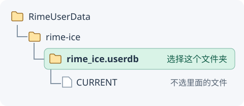

想看看键盘记住了哪些词？在元书首页的「文件管理」分组中，点「LevelDB」。下面以雾凇拼音的用户词库 `rime_ice.userdb` 为例进行说明。使用其他方案时，换成自己的词库名称即可。

## 第一步：打开要查看的词库

**如果想看键盘刚学到的词**，先把键盘词库复制到应用里。键盘和应用各有一份词库，并不会实时更新彼此的内容。

1. 在 LevelDB 首页，点右上角「…」→「复制键盘数据库」。
2. 这一步会复制键盘里各个方案的用户词库。**应用中对应位置的同名词库会被整个替换，无法撤销。** 如果想保留应用里的词条，先在「最近打开」列表中向左滑动该词库，点「导出」，选好保存位置，再回来复制。
3. 在「复制结果」中确认需要的词库已复制。如果显示因占用跳过，等键盘不再使用该库、RIME 部署或同步结束后再试。

**如果词库已经在应用里**，不用复制。直接点 LevelDB 首页右上角「…」→「打开数据库」，在 `RimeUserData` 中进入自己的方案目录，选中以 `.userdb` 结尾的**文件夹**。如果提示「缺少 CURRENT 文件」，请对照下图检查：要选的是装着 `CURRENT` 的文件夹，而不是 `CURRENT` 本身。

下次可以直接点「最近打开」中的词库。左滑点「移除」只会清掉这条记录，不会删除词库。

## 第二步：找到一个词

打开词库后，根据手头的线索选择搜索方式：

- **记得词语**：选「包含」，输入 `你好`。它会在整条记录中查找这两个字，不要求它们出现在开头。词库较大时可能要等一会儿，也可以取消搜索。
- **记得编码**：选「前缀」，输入 `ni hao`。它只找 Key 以 `ni hao` 开头的记录，适合查看同一串编码下有哪些词。

点开一条结果，会看到 **Key** 和 **Value**。在这个例子里，Key 包含编码 `ni hao` 和词语「你好」；Value 是 RIME 为这个词保存的数据，可能是 `c=1 d=1 t=5` 这样的文本。默认的「解析视图」把这些内容分栏显示。想看未经拆分的 Key 和 Value，点右上角「…」→「原始视图」。

**如果只是查词，看到这里就完成了，无需保存，也不用复制回键盘。**

## 想删掉一个词，或修改它的数据？

先留一份原库副本。删除和保存修改都不能撤销。

- **删一个词**：在列表里找到它，左滑该行，点「删除」并确认。要一次删多个，点顶部的圆圈勾选按钮，选好后核对「删除」旁的数量，再确认。
- **改编码或词语**：点开词条，点 **Key** 旁的编辑按钮。例如，要纠正词语里的错别字，只改「词语」一栏，「编码」保持不动，再点「保存」并确认。元书会保留原有的分隔符和整段 Value，不需要你重新填写调频数据。
- **改调频等数据**：点 **Value** 旁的编辑按钮。这里改的是整段 Value，不会改动编码或词语。如果不清楚某个字段的含义，请保留原值。

只有能识别出编码和词语的 RIME 用户词条才会分成两栏。如果看到的是「原始 Key」（例如 Lua 脚本创建的库），请按原库格式编辑；`\t` 表示制表符，`\xNN` 表示一个字节，`\\` 表示反斜杠本身。

如果提示新 Key 已存在，本次修改不会写入，两条记录都会保留。如果原记录在编辑期间已被修改或删除，请返回列表重新查看。元数据只读，也不能把普通记录改成以 `\x01` 开头的元数据 Key。

这些操作改的是**当前打开的词库**。要让键盘使用改好的应用副本，在词库页点「…」→「复制到键盘」，核对路径后点「复制并覆盖」。与第一步不同，这次只复制**当前这一个库**；它必须位于应用的 `RimeUserData` 里面。也可以在「最近打开」中左滑该库，选择「复制到键盘」。

:::caution[写回前，留意键盘有没有学到新词]
「复制到键盘」是整库替换，不是只把刚才的修改写回去。如果键盘在你编辑期间又学了词，这些新词会被应用里的旧副本覆盖。要保留两边的词，请先分别保留副本，再用下节的快照合并。提示数据库正在使用时，本次不会复制，请稍后再试。
:::

## 拿到一份 `.userdb.txt`，怎么合并进来？

`rime_ice.userdb` 是可以直接打开的**词库文件夹**；`rime_ice.userdb.txt` 则是一份**文本快照**，用来在 RIME 用户词典之间传递词条。拿到 `.userdb.txt` 时，不用「打开数据库」选这个文件。

1. 先打开**接收词条**的用户词库。如果要保留键盘现有的词，就用键盘词库的最新副本作为接收方。
2. 在词库页点「…」→「导入…」，选择 `.userdb.txt`。文件和接收方都必须是 RIME 用户词典，文件不能超过 50 MB。
3. 核对词库名称、有效条目数和无效行数。若提示名称不同，请确认没有选错词库。需要留存导入前的词条时，可点「先导出当前库」。
4. 点「导入」。元书按 RIME 的同步规则**合并**词条：例如，当前库里有「早上好」，快照里没有，这个词也会保留。要在键盘上使用合并结果，再把合并后的库「复制到键盘」。

要**制作快照**，在「最近打开」列表中向左滑动来源词库，点「复制到键盘」与「移除」之间的「导出」，再选择保存位置。如果已经打开词库，点右上角「…」→「导出…」即可。两个入口生成相同格式的 `.userdb.txt` 快照，都不受搜索条件影响。不符合 RIME 用户词典格式的记录会跳过，完成后会提示数量。尤其是 Lua 脚本写入的 LevelDB，不要把这种文本快照当作完整备份。

## 其他查看与维护操作

- **查看词库信息**：点顶部的 ⓘ，可看路径、大小、条数和元数据。元数据是词库自身的信息，不参与搜索，也不能手动修改或删除。
- **查看原始数据**：在条目详情中可复制 Key 和 Value，查看字节长度和十六进制内容。前缀搜索和 Value 编辑支持 `\t`（制表符）和 `\xNN`（一个字节）；编辑时用 `\\` 表示反斜杠本身。
- **调整顺序或刷新**：在「…」菜单里选择「按 Key 正序」「按 Key 倒序」或「刷新」。
- **压缩数据库**：点「…」→「压缩数据库」。它会重新整理当前库的数据文件，不会生成压缩包。请等操作完成后再离开页面。
