import { Aside, Badge, Code } from "@astrojs/starlight/components";


## 标准动作

- `space`: 表示空格键
- `enter`: 表示回车键
- `tab`: 表示 Tab 键
- `shift`: 表示 Shift 键
- `backspace`: 表示删除键
- `deleteForward`: 表示向右删除键，即物理键盘的 Delete 键，删除光标右侧的一个字符。详见下方 [向右删除 deleteForward](#向右删除-deleteforward)。
- `dismissKeyboard`: 表示收起键盘
- `moveCursorBackward`: 表示光标左移
- `moveCursorForward`: 表示光标右移
- `returnPrimaryKeyboard`: 表示返回主键盘。主键盘指 `pinyin` 中文键盘或者 `alphabetic` 英文键盘类型。
- `returnLastKeyboard`: 表示返回上一个键盘。功能会按键盘切换顺序的逆序，返回上一个使用过的键盘类型。注意：当键盘切换到中文键盘 `pinyin` 时，会清空键盘切换栈，此时再触发返回上一个键盘动作无效。
- `symbolicKeyboardLockStateToggle`: 表示符号键盘锁定状态切换。锁定状态下，点击符号键盘中的符号键不会切换回主键盘。符号键盘指类型为 `symbolic` 的键盘。
- `settings`: 表示打开主应用界面。
- `nextKeyboard`：表示切换到 iOS 系统键盘列表中的下一个键盘。

配置示例：

```yaml
action: space
```

## 向右删除 deleteForward

`deleteForward`: 与 `backspace` 方向相反，删除光标右侧的内容。

- 点击一次，删除光标右侧的一个字符（emoji 按整体删除）。
- 有选中文字时，删除选中的文字。
- 输入中（有编码）时，删除编码中光标右侧的部分，不会删除已上屏的文字。
- 光标右侧没有内容时，不做任何操作。

长按连续删除需要同时配置 `repeatAction`；长按时始终逐字删除，不会像 `backspace` 那样加速成按词、按句删除。

配置示例：

```yaml
action: deleteForward
repeatAction: deleteForward
```

<Aside type="tip" title="注意">
  - 需 TF >= 578，商店 >= 1.12.1 版本
</Aside>


## 字符输入 character

`character`: 表示输入一个字符。此符号会发送给输入法引擎 rime，输入法引擎会根据当前的输入状态决定如何处理这个字符。

配置示例：

```yaml
action: { character: 'a' }
```

## 符号输入 symbol

`symbol`: 表示输入一个符号。此符号会直接发送给系统，不会经过输入法引擎 rime。

配置示例：

```yaml
action: { symbol: '!' }
```

## 发送组合符号

`sendKeys`: 表示发送一组符号给输入法引擎 RIME。

<Aside type="caution" >
此动作仅对 RIME 引擎起作用，并不能产生类似物理键盘中的 Ctrl+a 全选的效果。
</Aside>

- 当需要辅助键（如 Shift、Ctrl、Alt）时，可以在辅助键后加上 `+` 号，表示按下该辅助键。
- 多个字符之间无需用 `+` 号连接，直接写在一起即可。

配置示例：

```yaml
action: { sendKeys: 'Shift+a' }
action: { sendKeys: 'nihao' }
```

## 模拟实体键盘按键 sendKeyEvent

<Badge text="Android" variant="success" size="medium" />

`sendKeyEvent`: 模拟在实体键盘上按下一个组合键。按键**不经过**输入法引擎 rime，直接发送给当前应用的输入框，效果和用外接键盘按下这个组合键相同。

与 `sendKeys` 的区别：`sendKeys` 把按键发给 rime，由 rime 决定如何处理；`sendKeyEvent` 跳过 rime，由当前应用处理，适合光标移动、选择文字、应用内快捷键等操作。

写法：

- 用 `+` 连接键名，前面是修饰键，最后一个是主键，例如 `Ctrl+Shift+Left`。
- 键名不区分大小写。
- 一个动作只发送一个组合键。需要依次发送多个组合键时，请使用 [组合 Action](#组合-action)。

修饰键：`Ctrl`（或 `Control`）、`Alt`（或 `Option`）、`Shift`、`Meta`（或 `Cmd`、`Command`、`Super`、`Win`）。

主键：

| 类别 | 键名 |
| --- | --- |
| 字母、数字 | `a` ~ `z`、`0` ~ `9` |
| 标点 | `` ` `` `-` `=` `[` `]` `\` `;` `'` `,` `.` `/` |
| 功能键 | `F1` ~ `F12` |
| 方向与翻页 | `Left`、`Right`、`Up`、`Down`、`Home`、`End`、`PageUp`、`PageDown` |
| 编辑 | `Tab`、`Enter`、`Esc`、`Backspace`、`Delete`（向右删除）、`Insert`、`Space` |

也兼容 rime 的键名，例如 `Return`、`Escape`、`BackSpace`、`Page_Up`、`Page_Down`、`comma`、`period`。

行为说明：

- 输入中（有编码）时，先清空编码（编码不上屏），再发送按键。
- 显示联想候选时，先关闭联想，再发送按键。
- 输入焦点在键盘内的输入框（如 AI、搜索面板的输入框）时，不做任何操作。
- 键名写错时，不做任何操作。
- 最终效果由当前应用决定。例如单行输入框不处理 `Up` / `Down`；终端类应用会把 `Up` / `Down` 当作翻阅历史命令。

配置示例：

```yaml
# 光标移到上一行 / 下一行
action: { sendKeyEvent: 'Up' }
action: { sendKeyEvent: 'Down' }

# 光标移到全文开头 / 末尾
action: { sendKeyEvent: 'Ctrl+Home' }
action: { sendKeyEvent: 'Ctrl+End' }

# 从光标处向上选中一行文字（按住 Shift 再按 ↑）
action: { sendKeyEvent: 'Shift+Up' }

# 应用内快捷键：全选、撤销
action: { sendKeyEvent: 'Ctrl+A' }
action: { sendKeyEvent: 'Ctrl+Z' }
```

长按连续发送需要同时配置 `repeatAction`：

```yaml
action: { sendKeyEvent: 'Down' }
repeatAction: { sendKeyEvent: 'Down' }
```

<Aside type="caution" title="仅 Android">
  - 此动作仅元书 Android 版支持。
  - iOS 版无法识别此动作，使用此动作的按键在 iOS 上不会生效。跨平台共享的皮肤请避免使用。
  - 需要 Shift 才能输入的符号需显式写出 Shift，例如 `!` 写作 `Shift+1`。
</Aside>

## 切换 RIME Option 选项状态

`rimeOption`: 调整 RIME Option 选项状态。此选项对应的值为方案配置中 Option 的名称。

配置示例：

```yaml
action: { rimeOption: 'ascii_mode' }
```

<Aside type="tip" title="注意">
  - 需 TF >= 504，商店 >= 1.8.0 版本
  - 如果 option 选项存在三个及三个以上，无法使用此方法进行切换。
  - RIME 不会记忆通过此方法切换的 option 状态，如需记忆 option 状态，请使用 `rimeSwither` 切换。
</Aside>

## 执行 AI 指令

`ai`: 表示执行一个 AI 指令。此指令会在后台执行，不会弹出命令页面。

配置示例：

```yaml
action: { ai: 'AI 指令名称' }
```

<Aside type="tip" title="注意">
  - 需 TF >= 505，商店 >= 1.8.0 版本
  - AI 指令名称对命令面板页面中 AI 指令下维护的指令名称
  - AI 指令执行期间无法执行其他 shortcut 指令
  - 指令中的 `{{input}}` 会使用「光标前文字+选中文字+光标后文字」替换，若没有选中任何文字，则只使用光标前文字+光标后文字替换。
</Aside>

## 常用语

`phrase`: 表示调用一个常语语

配置示例：

```yaml
action: { phrase: '常用语 title' }
```

<Aside type="tip" title="注意">
  - 需 TF >= 513，商店 >= 1.8.0 版本
  - 需要为常用语添加一个 title
</Aside>

## Snippet

`snippet`: 表示一个模板片段，它的功能与常用语是完全相同的。它省略了常用语创建的步骤，可以将常用语的内容，直接放到这个条指令中。

配置示例：

```yaml
action: { snippet: '这是一个日期：{{date:yyyy-MM-dd}}' }
```

注意：常用语下的内置变量与自定义变量在这里都可以使用，具体请查阅 [常用语](/apps/hamster/v3/docs/guides/phrase/#时间格式中预定义的字符串含义)
  
<Aside type="tip" title="注意">
  - 需 TF >= 514，商店 >= 1.8.0 版本
</Aside>

## 打开链接

`openURL`: 表示打开一个链接。

配置示例：

```yaml
action: { openURL: 'https://imfuxiao.github.io/Hamster3Document' }
```

打开链接的特殊用法：

- 使用 `#pasteboardContent` 表示打开剪贴板内容作为链接。

配置示例：

```yaml
action: { openURL: '#pasteboardContent' }
```

- 使用 `#selectText` 表示打开当前选中内容作为链接。

配置示例：

```yaml
action: { openURL: '#selectText' }
```

- 以上两种特殊用法可以结合使用。

配置示例：

```yaml
action: { openURL: '#pasteboardContent#selectText' }
```

### 打开元书内的文件或目录

`openURL` 也可以打开元书主应用的 URL Scheme。通过 `finder` 页面配合 `action` 参数，可以直接跳转到「文件管理」中的指定目录或文件，方便在键盘上一键编辑皮肤、方案等配置文件。

URL 格式：

```
hamster3://com.ihsiao.apps.hamster3/finder?action=<动作>&<参数>=<值>
```

支持以下三种动作：

- `openSkinsFolder`：打开指定皮肤的目录。
  - `name`：皮肤目录名称，即 `Skins` 目录下的子目录名。

配置示例：

```yaml
action: { openURL: 'hamster3://com.ihsiao.apps.hamster3/finder?action=openSkinsFolder&name=我的皮肤' }
```

- `openSkinsFile`：打开**当前使用的皮肤**下的文件，并直接进入文本编辑页面。
  - `fileURL`：文件相对于当前皮肤目录的路径。

配置示例：

```yaml
action: { openURL: 'hamster3://com.ihsiao.apps.hamster3/finder?action=openSkinsFile&fileURL=jsonnet/Components/Utils.libsonnet' }
```

- `openAppFile`：打开应用目录下的任意文件，并直接进入文本编辑页面。
  - `fileURL`：文件相对于应用根目录（即「文件管理」中的应用文件根目录，包含 `Rime`、`Skins` 等目录）的路径。

配置示例：

```yaml
action: { openURL: 'hamster3://com.ihsiao.apps.hamster3/finder?action=openAppFile&fileURL=Rime/default.custom.yaml' }
```

<Aside type="tip" title="注意">
  - `openSkinsFolder`、`openAppFile` 需商店 >= 1.5.5 版本；`openSkinsFile` 需商店 >= 1.6.8 版本
  - 打开文件时，会先进入文件所在目录，再打开文本编辑页面，编辑完成返回后停留在该目录。
  - 路径以 `/` 分隔，不要以 `/` 开头。路径中包含中文、空格等特殊字符时，建议先进行 URL 编码（如空格写为 `%20`）。
</Aside>

## 运行指定脚本

`runScript`: 表示运行指定脚本。

配置示例：

```yaml
action: { runScript: 'myScript' }
```

## 静默执行 JavaScript 脚本

`runScriptSilently`: 表示静默执行一个 JavaScript 脚本。此脚本会在后台执行，不会弹出脚本页面。

配置示例：

```yaml
action: { runScriptSilently: '脚本名称' }
```

<Aside type="tip" title="注意">
  - 需 TF >= 505，商店 >= 1.8.0 版本
  - 脚本名称对应脚本页面中维护的脚本名称
  - 指令中的 $searchText 变量使用「光标前文字+选中文字+光标后文字」替换，若没有选中任何文字，则只使用光标前文字+光标后文字替换。
  - 脚本执行期间无法执行其他 shortcut 指令
</Aside>


## 键盘切换

`keyboardType`: 表示切换到指定类型的键盘。

系统规定了以下几种键盘类型：

- `pinyin`: 拼音中文键盘
- `alphabetic`: 英文键盘
- `symbolic`: 符号键盘
- `numeric`: 数字键盘
- `emojis`: Emoji 键盘

配置示例：

```yaml
action: { keyboardType: 'pinyin' }
```

除了以上几种系统键盘类型外，用户还可以自定义其他键盘类型。

配置示例：

```yaml
action: { keyboardType: '自定义键盘名称' }
```

## 快捷指令

`shortcut`: 表示执行一个快捷指令。

系统预定义了以下快捷指令：

- `#简繁切换`：简体与繁体切换。
- `#中英切换`：中文与英文切换。注意此切换是指 rime 中 ascii_mode 的切换，非键盘类型切换。
- `#RimeSwitcher`：进入 rime switch 状态。
- `#次选上屏`：将当前第二个候选文字上屏。
- `#三选上屏`：将当前第三个候选文字上屏。
- `#方案切换`：显示当前方案切换页面，用于切换当前方案列表中的其他方案。
- `#左手模式`：切换到单手模式下的左手模式。
- `#右手模式`：切换到单手模式下的右手模式。

- `#行首`：光标移动到当前行的行首。
- `#行尾`：光标移动到当前行的行尾。
- `#换行`：插入一个 `\r`。
- `#Enter`：插入一个 `\n`。
- `#重输`：清空已键入的 preedit 内容。

- `#subCollectionPageUp`：子分类符号页向上翻页。
- `#subCollectionPageDown`：子分类符号页向下翻页。
- `#verticalCandidatesPageDown`: 纵向候选栏向下翻页。
- `#verticalCandidatesPageUp`: 纵向候选栏向上翻页。
- `#showPhraseView`：显示常用语视图。
- `#showPasteboardView`：显示剪贴板视图。
- `#toggleScriptView`：脚本页面显示与隐藏切换。
- `#candidatesBarStateToggle`: 候选栏状态切换。用来展开候选文字或收起候选文字。
- `#rimePreviousPage`：rime 候选页向前翻页。仅在开启手工分页模式下有效。
- `#rimeNextPage`：rime 候选页向后翻页。仅在开启手工分页模式下有效。
- `#toggleEmbeddedInputMode`：内嵌模式状态切换。
- `#keyboardPerformance`：显示当前键盘性能信息。
- `#keyboardMenu`：显示键盘菜单页面
- `#clearSystemPasteboard`: 清空系统剪贴板中内容
- `#toggleSplitState`: 切换键盘分体状态

配置示例：

```yaml
action: { shortcut: '#candidatesBarStateToggle' }
```

## 切换 RIME 方案

`switchRimeSchema`: 表示切换到指定 RIME 方案。

配置示例：

```yaml
action: { switchRimeSchema: '方案ID或方案名称' }
```

<Aside type="tip" title="注意">
  建议使用方案 ID 进行切换，因为方案名称可能会发生变化。
</Aside>

- v1.4.0 及以上版本有效

## 发送系统通知

`userNotification`: 表示由键盘发送一条系统通知。通知正文为 JSON 格式，包含快捷指令名称与内容，可供快捷指令自动化读取使用。

参数支持以下两种写法：

- 简单写法：表示希望运行的 Shortcut 名称

配置示例：

```yaml
action: { userNotification: 'Shut Down' }
```

对应通知内容

```json
{
  "shortcutName": "Shut Down"
}
```

- 完整写法：支持以下字段：
  - `shortcutName`：快捷指令名称，必填。
  - `content`：通知携带的内容，可选，默认为空。
  - `notifyTitle`：通知标题，可选，默认为「元书输入法」。

配置示例：

```yaml
action: { userNotification: "{ shortcutName: 'Shut Down', content: '#selectText', notifyTitle: '关机' }" }
```

`content` 的特殊用法：

- 使用 `#selectText` 表示使用当前选中的文字作为内容。
- 使用 `#pasteboardContent` 表示使用剪贴板内容作为内容。

发送的通知正文示例：

```json
{"notifyTitle":"关机","shortcutName":"Shut Down","content":"选中的文字"}
```

<Aside type="tip" title="注意">
  - TF >= 563，商店 >= 1.12.0
  - 需开启键盘「完全访问」权限。
  - 需先打开一次主应用并允许通知权限。键盘无法自行申请通知权限，未授权时会提示「通知未授权」。
  - 完整写法的映射需整体用引号包裹成字符串，否则无法识别。
  - `content` 的值需与 `#selectText` 或 `#pasteboardContent` 完全一致才会被替换，不支持与其他文字组合。
</Aside>

### 在 Shortcut 应用使用元书通知

iOS Shortcut 中可通过指定应用的「通知」自动化触发某条指令。

方法：

- 新建指令
- 选择 「Automation」，选择「Apps」下的「Notification」
- 点击 「App」参数，选择「元书输入法」

可选项:

- Add Filter: 你可以根据「通知」中的输入参数 `notifyTitle` 设置通知的 Title，进一步在这里通过 Title 过滤通知

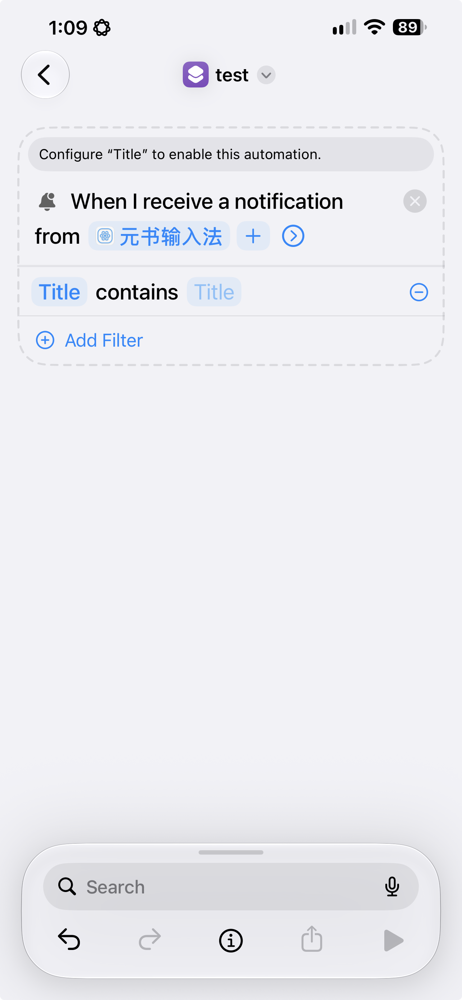


如何读取通知中的内容？

- 选择「Scripting」后，选择「Dictionaries」下的「Get Dictionary from Input」选项
- 点击上个选项中的「Input」，选择「Notification」，选择后，再次点击「Notification」选项，选择「Body」，表示读取通知中的内容。

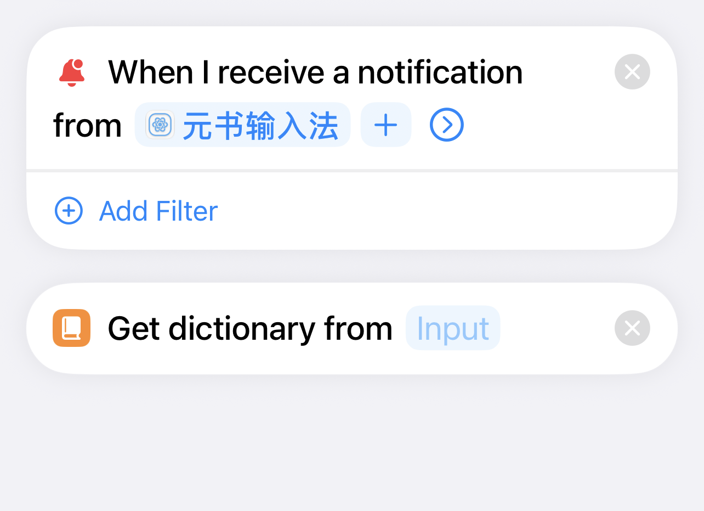
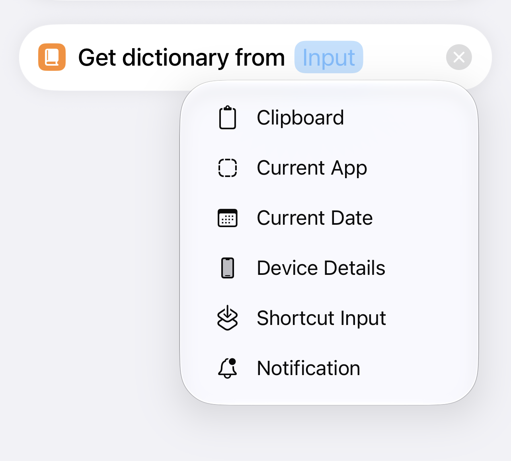
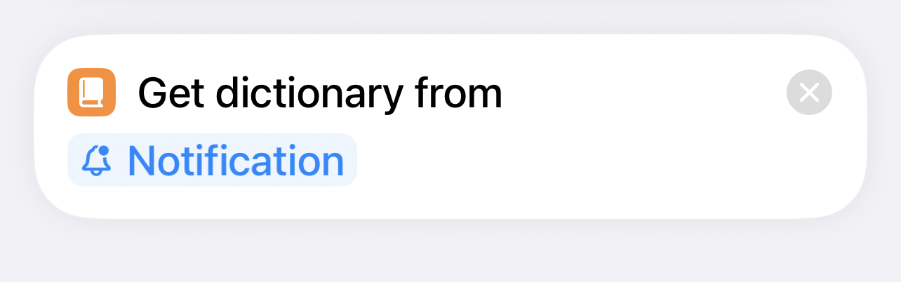
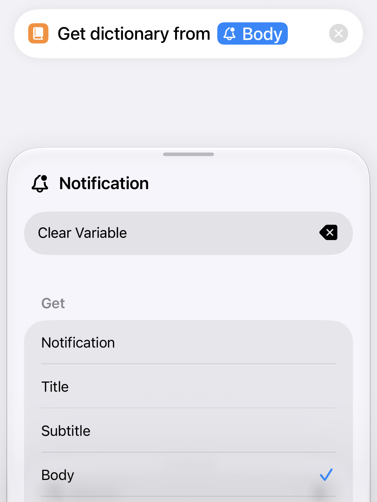
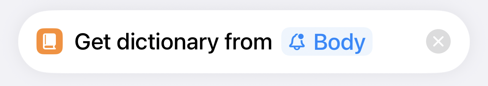


如何运行指定名称的 Shortcut？

在上一步「如何读取通知中的内容」中读取到了通知内容，通知内容是一个字典，其中字典的 `shortcutName` 表示希望运行的 Shortcut。

- 选择「Scription」后，选择「Shortcuts」下的「Run Shortcut」
- 点击「shortcut」，选择「Select Variable」选项，默认系统将整个字典内容传给了参数，这里需要调整下：
  - 点击「Dictionary」引用，获取自定义参数选项
  - 选择「Dictionary」参数，在页面「Get Value for Key」输入栏中输入 `shortcutName`，表示从字典中获取 `shortcutName` 对应的值作为运行 Shortcut 的名称
    > 获取字典中的其他 key 对应的内容是类似的操作

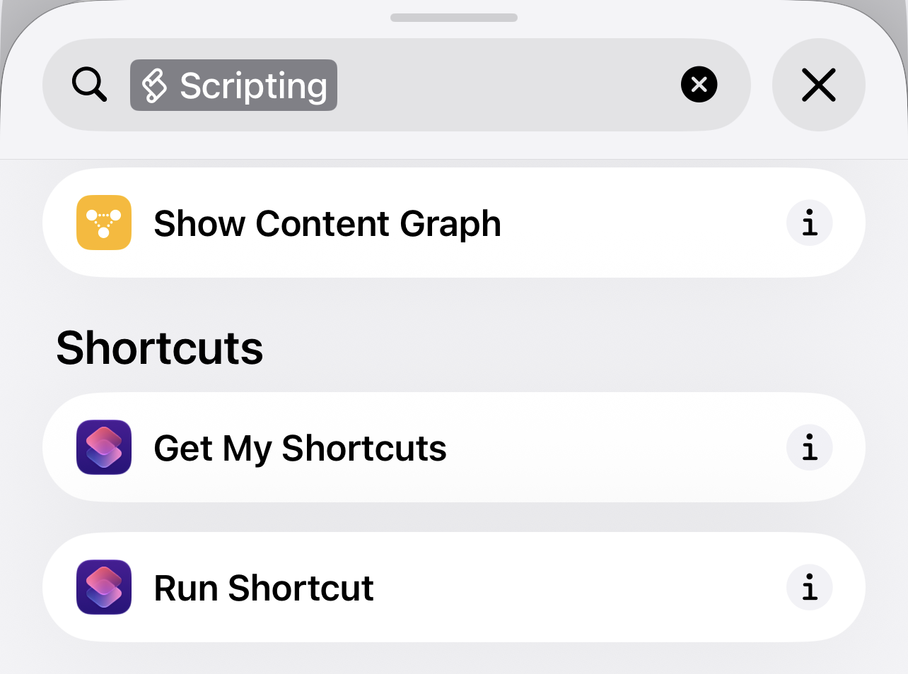
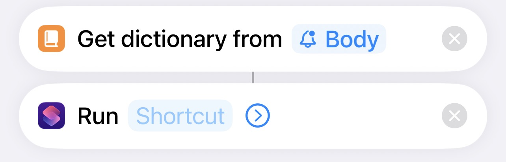
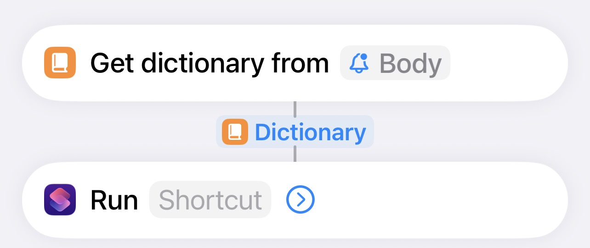
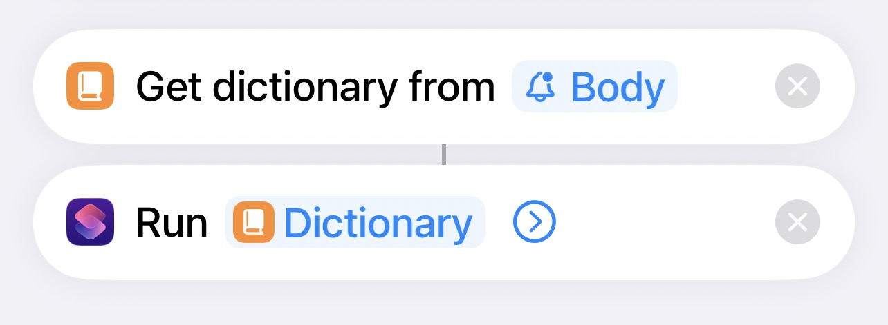
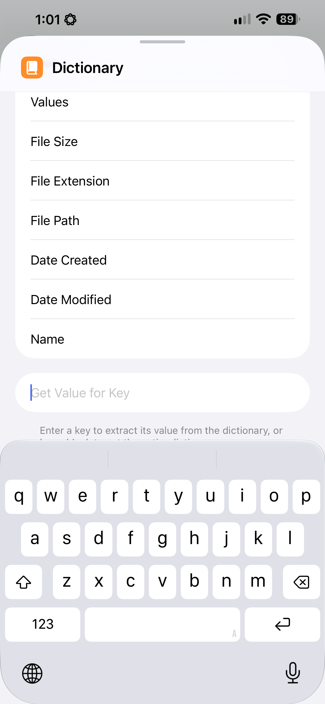
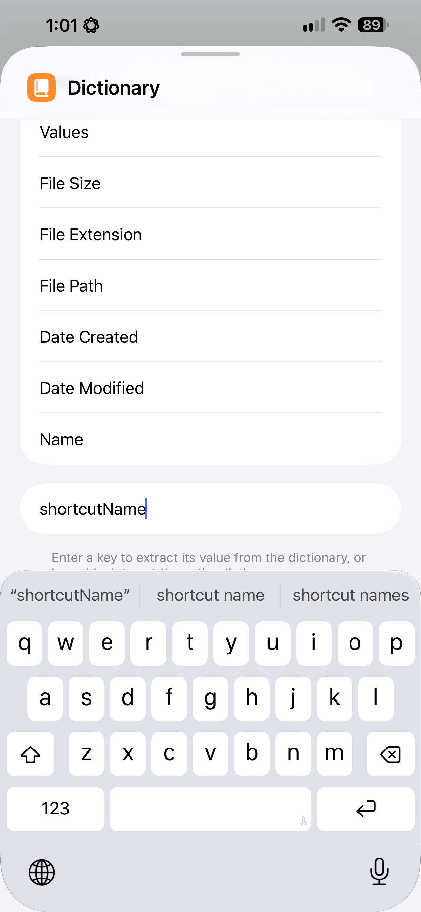
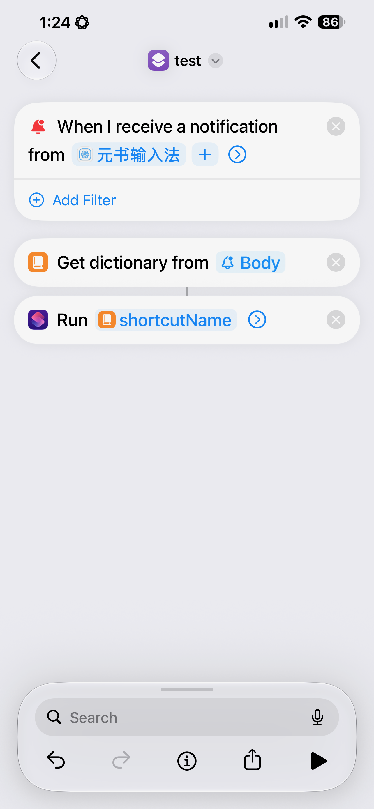

## 组合 Action

`combine`：组合 action，用于触发多个 action

配置示例：

- 切换到英文键盘且将输入方案转为 melt_eng

``` yaml
action:
  combine:
    - keyboardType: alphabetic
    - switchRimeSchema: melt_eng
```

<Aside type="tip" title="注意">
  - 需 TF >= 349 版本
</Aside>

## 延迟 Action

在使用组合指令时，某两个指令之间可能需要强制延迟一段时间，此时可以使用延迟指令。

延迟指令中的参数为整数类型，单位毫秒（1秒=1000毫秒），表示将下一条指令延迟指定时间后执行。

此指令只能在 combine 指令下使用，其他地方使用无效。

```yaml
action:
  combine:
    - keyboardType: alphabetic
    - delay: 1000
    - switchRimeSchema: melt_eng
```

<Aside type="tip" title="注意">
  - 需 TF >= 510 版本，商店 >= 1.8.0
</Aside>
