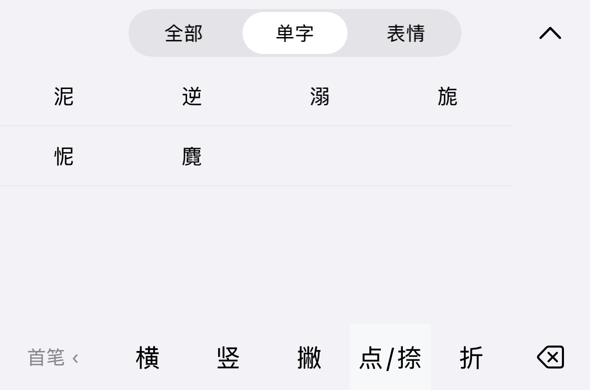

import { Code } from '@astrojs/starlight/components';
import practice from '../../../../examples/skins/candidate-filter-practice.yaml?raw';
import practiceURL from '../../../../examples/skins/candidate-filter-practice.yaml?url&no-inline';


候选字筛选面板是新增的一个候选字显示面板，它提供了对候选字筛选的功能。



上图已显示范围选项并展开首笔筛选。

注意: 

- 默认「单字」「表情」筛选 tab 是隐藏的，需要时向下滑动
- 此面板不支持自定义布局，但提供了部分样式调整的方法（详见下方「如何调整候选字筛选面板样式」

## 如何使用这个面板

旧的展开候选字面板是通过 `verticalCandidatesLayout` 进行自定义布局后，再通过 `#candidatesBarStateToggle` action 展开或收起候选字面板。

新的筛选面板，不支持自定义布局，所以不需要配置它的布局内容，它是通过新增的 `#candidateFilterPanelToggle` action 展开或收起候选字面板。

所以旧的皮肤依旧使用的是自定义的候选字展开面板。如需使用带筛选的面板，需要将皮肤中使用 `#candidatesBarStateToggle` 的 `action`，将它改为：

```yaml
action: { shortcut: '#candidateFilterPanelToggle' }
```

## 如何调整候选字筛选面板样式？

`candidateFilterPanelStyle` 是可选配置，可以分别设置候选、笔形（首笔筛选）、工具按钮和空结果提示的样式。

| 部件 | 对应位置 | 状态说明 |
| --- | --- | --- |
| `candidate` | 列表中的字、词或表情候选 | `normal` 为普通状态；`selected` 为当前 Rime 菜单原本高亮的候选，不是筛选后的第一项；`pressed` 为手指按住时的状态。高亮背景只包围文字，但整个候选格都可以点击。 |
| `stroke` | 展开后的横、竖、撇、点/捺、折五个按钮，不包含「首笔」入口 | 未选中时使用 `normal`，选中后使用 `selected`，按住时使用 `pressed`。未指定的颜色沿用候选对应状态的颜色。 |
| `tool` | 右上角的收起按钮、右下角的退格键、底部「首笔」入口，以及上方「全部／单字／表情」选项 | 工具按钮使用普通和按住状态的颜色。「首笔」展开后只改变箭头，不保持选中颜色。上方范围选项使用普通和选中的文字颜色，选中项的背景使用选中背景色。 |
| `heading` | 没有结果时的提示，例如「未找到表情」 | 可以设置 `normal` 中的文字颜色、背景色，以及部件字号。它不是常驻标题，也没有可操作的选中状态。 |

### 完整配置示例

下面是一套浅色配色，包含面板背景、共用样式，以及各部件的字号和颜色。将它添加到对应的键盘 YAML 文件最外层，与 `horizontalCandidatesLayout` 同级，不要放进 `config.yaml`。

```yaml
candidateFilterPanelStyle:
  # 整个面板的背景，与下方各部件的背景分开设置。
  backgroundColor: '#F3F8F5'

  # 共用样式；部件中可以单独覆盖。
  fontSize: 17
  normal:
    textColor: '#20382F'
    backgroundColor: '#00000000'
  selected:
    textColor: '#FFFFFF'
    backgroundColor: '#146451'
  pressed:
    textColor: '#FFFFFF'
    backgroundColor: '#0D483B'

  # 候选字、词和表情。
  candidate:
    fontSize: 20
    normal:
      textColor: '#20382F'
      backgroundColor: '#00000000'
    selected:
      textColor: '#FFFFFF'
      backgroundColor: '#146451'
    pressed:
      textColor: '#FFFFFF'
      backgroundColor: '#0D483B'

  # 横、竖、撇、点/捺、折五个首笔按钮，不包含「首笔」入口。
  stroke:
    fontSize: 17
    normal:
      textColor: '#20382F'
      backgroundColor: '#00000000'
    selected:
      textColor: '#FFFFFF'
      backgroundColor: '#146451'
    pressed:
      textColor: '#FFFFFF'
      backgroundColor: '#0D483B'

  # 收起、退格、「首笔」入口和候选字上方范围筛选选项。
  tool:
    fontSize: 14
    normal:
      textColor: '#145C49'
      backgroundColor: '#00000000'
    selected:
      textColor: '#FFFFFF'
      backgroundColor: '#146451'
    pressed:
      textColor: '#092E24'
      backgroundColor: '#CBE5D7'

  # 没有结果时的提示信息
  heading:
    fontSize: 12
    normal:
      textColor: '#50665B'
      backgroundColor: '#00000000'
```

### 颜色与字号

| 字段 | 示例或格式 | 说明 |
| --- | --- | --- |
| `textColor` | `'#20382F'` | 文字颜色，工具图标也使用此颜色。直接写在当前层级下，是普通文字颜色的简写；如果同时设置了 `normal.textColor`，以后者为准。 |
| `backgroundColor` | `'#F3F8F5'` | 写在面板最外层时，设置整个面板的背景，也可作为部件普通背景色的后备值。写在部件中时，设置该部件的普通背景色。只设置面板最外层的 `normal.backgroundColor`，不会改变整个面板的背景。 |
| `normal` | 包含 `textColor`、`backgroundColor` 的对象 | 未选中、未按住时的颜色。示例将 `normal.backgroundColor` 设为透明，使普通候选格显示出面板的浅绿色背景。 |
| `selected` | 同上，可以只设置一种颜色 | 持续高亮时的文字颜色和背景色。候选、笔形和范围选项的选中状态含义不同，见上表。 |
| `pressed` | 同上，可以只设置一种颜色 | 手指按住时的颜色，松手后恢复。它与选中状态不同，也不用于控制上方系统分段控件的按压外观。 |
| `fontSize` | `17` | 字号，单位为点（pt）。填写大于零的有限数字，不要写成 `17pt`。不同状态不能分别设置字号。 |

颜色支持 6 位 RGB 和 8 位 RGBA，建议以 `#` 开头并加上引号。例如：

- `'#146451'`：不透明的深绿色。
- `'#14645180'`：相同的绿色，不透明度约为一半。
- `'#00000000'`：完全透明。

8 位颜色的最后两位表示透明度。不支持颜色名称或三位缩写。

当未配置某个属性颜色，或者颜色格式无效时，会回退到默认样式的颜色。

## 使用说明与常见问题

### 如何只看单字和表情？

打开筛选面板后，在列表顶部向下拉，即可显示「全部／单字／表情」三个范围选项。

### 为什么面板打开了，配色却没有变化？

确认 `candidateFilterPanelStyle` 位于键盘 YAML 文件的最外层，缩进使用空格，颜色值带有引号。

如果皮肤使用 Jsonnet，请检查生成后的键盘 YAML。旧版 `Style.prune` 可能会删除 `candidateFilterPanelStyle` 节点，需要将它加入 `structuralKeys`，或在执行 `prune` 后再合并面板样式。
