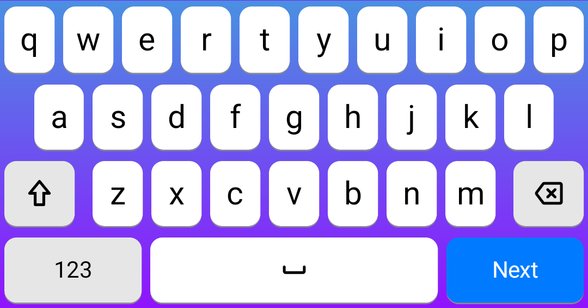
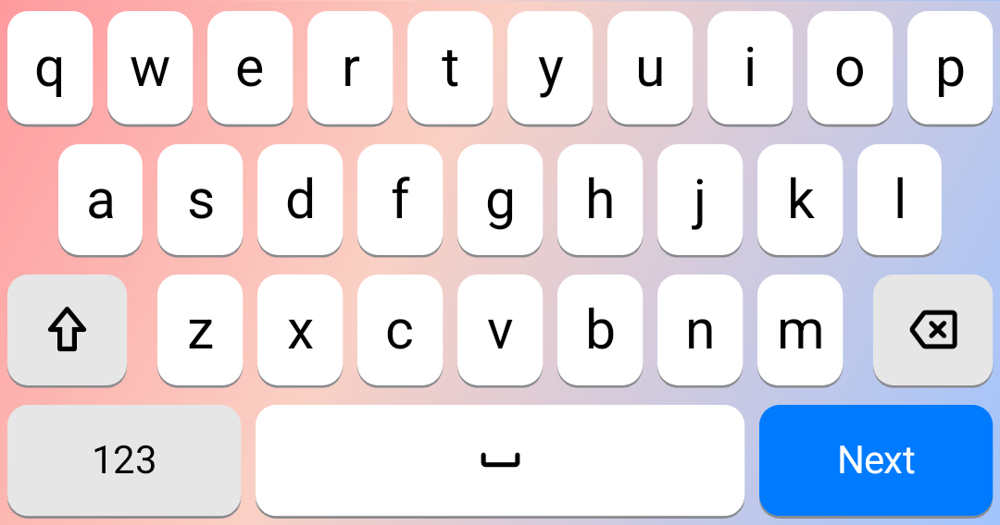
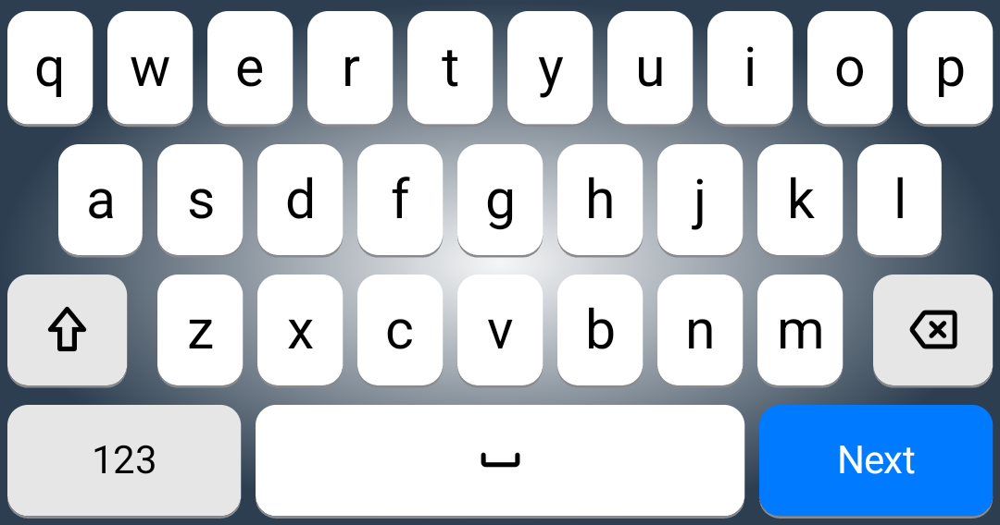
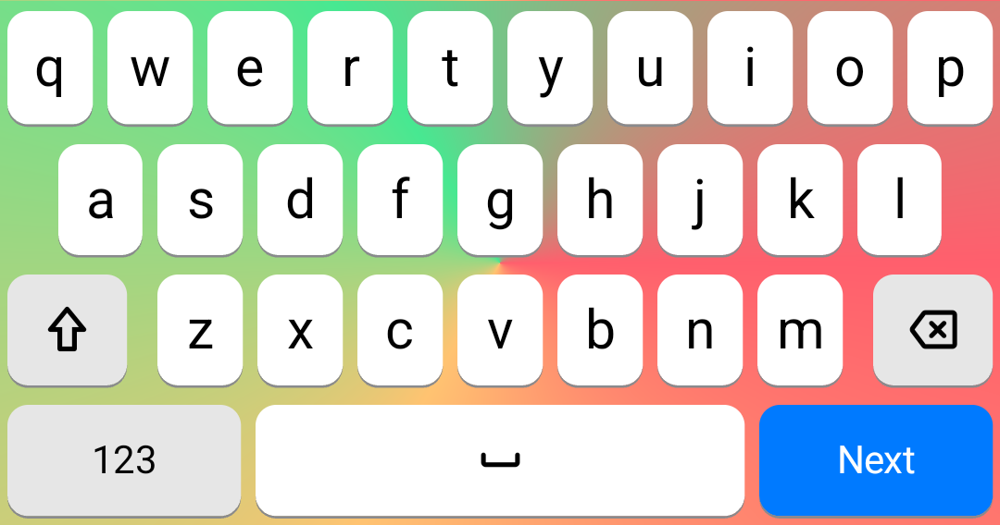

import { Aside } from "@astrojs/starlight/components";

样式可以通过 `backgroundStyle` 和 `foregroundStyle` 参数进行设置。

- `backgroundStyle`：设置背景样式，支持纯色、渐变色或图片等多种形式。
- `foregroundStyle`：设置前景样式，通常用于定义按键上的文本、图标或角标等元素样式。

## 背景样式

通过 `backgroundStyle` 参数进行设置。

**类型**：`'String' | [ConditionStyle]`

**是否必须**：否。不设置时，按键将使用默认背景样式。

> 参见条件样式 [ConditionStyle](/apps/hamster/v3/docs/guides/skins/parameters/#conditionstyle-条件样式)

## 前景样式

通过 `foregroundStyle` 参数进行设置。

**类型**：`'String' | [String] | [ConditionStyle]`

**是否必须**：否。不设置时，按键将使用默认前景样式。

> 参见条件样式 [ConditionStyle](/apps/hamster/v3/docs/guides/skins/parameters/#conditionstyle-条件样式)

前景样式与背景样式的不同之处在于，前景样式可以是一个字符串数组，表示按键上可以叠加显示多个前景样式。

## 样式类型

无论是背景样式还是前景样式，都必须指定其样式类型。

样式类型通过 `buttonStyleType` 参数进行设置。

**类型**：`'geometry' | 'systemImage' | 'assetImage' | 'fileImage' | 'text'`

各样式类型说明：

- `geometry`：使用 iOS 原生属性绘制样式
- `systemImage`：使用 SF Symbols 图标作为样式
- `assetImage`：使用应用内置资源图片作为样式
- `fileImage`：使用皮肤中的图片文件作为样式
- `text`：使用文本内容作为样式

### geometry

通过设置 `buttonStyleType` 参数为 `geometry`，使用 iOS 原生属性绘制样式。

它包含以下参数：

- `insets`：设置样式的内边距，在按键可视区域内进一步缩小样式的显示区域。
    - 类型：`{ top: Double, left: Double, bottom: Double, right: Double }`
    - 默认值：`{ top: 0, left: 0, bottom: 0, right: 0 }`
- `normalColor`：未按下时的颜色
    - 类型：`String | [String]`
    - 支持单色或渐变色，使用数组表示渐变色
- `highlightColor`：按下时的颜色
    - 类型：`String | [String]`
    - 支持单色或渐变色，使用数组表示渐变色
- `colorLocation`：颜色位置，用于渐变色（单色时无效）
   - 类型：`[Double]`
   - 取值范围：`0.0` 到 `1.0`
- `colorStartPoint`：渐变开始位置（单色时无效）
    - 类型：`{ x: Double, y: Double }`
    - 取值范围：`0.0` 到 `1.0`
    - 默认值：`{ x: 0.5, y: 0.0 }`（表示从顶部中间开始渐变）
- `colorEndPoint`：渐变结束位置（单色时无效）
    - 类型：`{ x: Double, y: Double }`
    - 取值范围：`0.0` 到 `1.0`
    - 默认值：`{ x: 0.5, y: 1.0 }`（表示从底部中间结束渐变）
- `colorGradientType`：渐变类型，用于定义渐变的方式。
    - 类型：`枚举`，可选，默认值为 `axial`
        - `axial`：线性渐变
        - `conic`: 锥形渐变
        - `radial`: 辐射状渐变
- `cornerRadius`：设置圆角半径
    - 类型：`Double`
- `borderSize`：设置边框宽度
    - 类型：`Double`
- `normalBorderColor`: 未按下时边框颜色。**边框宽度与边框颜色需同时设置才会显示边框**
    - 类型：`String`
- `highlightBorderColor`: 按下时边框颜色。**边框宽度与边框颜色需同时设置才会显示边框**
    - 类型：`String`
- `normalLowerEdgeColor`：未按下时底部边缘的颜色
    - 类型：`String`
- `highlightLowerEdgeColor`：按下时底部边缘的颜色
    - 类型：`String`
- `normalShadowColor`：未按下时的阴影颜色
    - 类型：`String`，默认为空，表示无阴影
- `highlightShadowColor`：按下时的阴影颜色
    - 类型：`String`，默认为空，表示无阴影
- `shadowOpacity`：设置阴影透明度，
    - 类型：`Double`，取值范围：`0.0` 到 `1.0`，默认为 1，表示不透明
- `shadowRadius`：设置阴影模糊半径。
    - 类型：`Double`，默认为 3
- `shadowOffset`：设置阴影偏移
    - 类型：`{ x: Double, y: Double }`
    - 默认值：`{ x: 0, y: 3 }`

**配置示例：**

```yaml
geometryBackground:
  buttonStyleType: geometry
  insets: { top: 6, left: 3, bottom: 6, right: 3 }
  normalColor:
    - "#9bafd9"
    - "#103783"
  highlightColor:
    - "#432371"
    - "#faae7b"
  colorLocation: [0, 1]
  colorStartPoint: { x: 0.5, y: 0 }
  colorEndPoint: { x: 0.5, y: 1 }
  colorGradientType: radial
  cornerRadius: 6
  borderSize: 3
  normalBorderColor: '#f5d7a1'
  normalLowerEdgeColor: '#f5d7a1'
  highlightLowerEdgeColor: '#552E5A'
  normalShadowColor: '#e60b09'
  highlightShadowColor: '#e60b09'
  shadowRadius: 2
  shadowOffset: { x: 0, y: 3 }
  shadowOpacity: 0.8
```

#### 渐变色示例

以下示例以键盘背景样式 `keyboardBackgroundStyle` 为例，按键背景样式的写法相同。

`colorStartPoint` 与 `colorEndPoint` 使用单位坐标：左上角为 `{ x: 0, y: 0 }`，右下角为 `{ x: 1, y: 1 }`。

各示例下方为在 Android 上的实际效果（基于默认皮肤，仅截取按键区域）。

**线性渐变（`axial`）：从上到下**

```yaml
keyboardBackgroundStyle:
  buttonStyleType: geometry
  normalColor:          # 两个及以上颜色为渐变色，单个字符串为纯色
    - "#4A90E2"
    - "#9013FE"
  colorLocation: [0, 1] # 可省略，省略时颜色均匀分布
  colorStartPoint: { x: 0.5, y: 0 } # 顶部中间
  colorEndPoint: { x: 0.5, y: 1 }   # 底部中间
  colorGradientType: axial
```



**线性渐变（`axial`）：左上到右下，三色**

```yaml
keyboardBackgroundStyle:
  buttonStyleType: geometry
  normalColor:
    - "#FF9A9E"
    - "#FAD0C4"
    - "#A1C4FD"
  colorLocation: [0, 0.4, 1] # 中间色位于 40% 处
  colorStartPoint: { x: 0, y: 0 }
  colorEndPoint: { x: 1, y: 1 }
  colorGradientType: axial
```



**辐射状渐变（`radial`）：从中心向四周**

```yaml
keyboardBackgroundStyle:
  buttonStyleType: geometry
  normalColor:
    - "#FFFFFFCC" # 8 位颜色为 RRGGBBAA，CC 约为 80% 不透明
    - "#2C3E50"
  colorLocation: [0, 1]
  colorStartPoint: { x: 0.5, y: 0.5 } # 圆心
  colorEndPoint: { x: 1, y: 1 }       # 决定横向与纵向半径
  colorGradientType: radial
```



**锥形渐变（`conic`）：绕中心旋转一周**

```yaml
keyboardBackgroundStyle:
  buttonStyleType: geometry
  normalColor:          # 首尾颜色相同，接缝处过渡更自然
    - "#FF5F6D"
    - "#FFC371"
    - "#47E891"
    - "#FF5F6D"
  colorLocation: [0, 0.33, 0.66, 1]
  colorStartPoint: { x: 0.5, y: 0.5 } # 旋转中心
  colorEndPoint: { x: 1, y: 0.5 }     # 起始方向：指向右侧
  colorGradientType: conic
```



<Aside>
- `colorLocation` 的元素个数必须与颜色个数相同才会生效，否则颜色均匀分布。
- 不同渐变类型中，起止点的含义不同：
    - `axial`：从起点到终点为渐变方向。
    - `radial`：起点为圆心；终点与圆心在 x、y 方向上的距离分别为横向、纵向半径，因此可以形成椭圆。终点的 x 或 y 不要与圆心相同，否则该方向的半径接近 0。
    - `conic`：起点为旋转中心，终点只决定起始方向。
- `highlightColor` 同样支持数组形式，与 `normalColor` 共用 `colorLocation`、起止点与渐变类型。
</Aside>

### systemImage

通过设置 `buttonStyleType` 参数为 `systemImage`，使用 SF Symbols 图标作为样式。

在 Android 平台，SF Symbols 名称会自动映射为对应的 Material Icon；也可使用 `material:` 前缀直接指定 Material Icon，如：`material:add`。

它包含以下参数：

- `insets`：设置样式的内边距，在按键可视区域内进一步缩小样式的显示区域。
- `systemImageName`：图标名称
    - 类型：`String | { ios: String, android: String }`
      - 字符串：SF Symbols 图标名称（注意版本要求，部分 SF Symbols 需要在 iOS 高版本中才能使用）。在 Android 平台，添加 `material:` 前缀可直接使用 Material Icon。
      - 平台映射：按平台分别指定图标名称，键名必须为小写的 `ios`、`android`。
        - `ios`：iOS 平台使用的 SF Symbols 图标名称
        - `android`：Android 平台使用的 Material Icon 名称，无需添加 `material:` 前缀
        - 映射中缺少当前平台的键，或其值为空时，视为未设置
    - 示例：

      ```yaml
      # 字符串：iOS 使用 SF Symbols 的 globe；Android 自动映射为 Material Icon 的 language
      systemImageName: globe

      # 字符串 + material: 前缀：Android 直接使用 Material Icon 的 add（iOS 上无此图标）
      systemImageName: material:add

      # 平台映射：iOS 使用 delete.left，Android 使用 backspace
      systemImageName: { ios: delete.left, android: backspace }

      # 平台映射也可以写成多行
      systemImageName:
        ios: delete.left
        android: backspace
      ```
- `highlightSystemImageName`: 按下时的图标名称（可选，未设置时使用 `systemImageName`）。
    - 类型：同 `systemImageName`
    - 示例：

      ```yaml
      systemImageName: { ios: shift, android: shift }
      # iOS 按下时显示 shift.fill；
      # Android 映射中没有 android 键，视为未设置，按下时回退使用 systemImageName 的 shift
      highlightSystemImageName: { ios: shift.fill }
      ```
- `contentMode`：设置图片的显示模式
    - 类型：枚举，默认为 `center`
        - `scaleToFill`：拉伸填充
        - `scaleAspectFit`：按比例缩放以适应
        - `scaleAspectFill`：按比例缩放以填充
        - `center`：居中显示
- `fontSize`：设置图标的大小。
    - 类型：`Double`
- `fontWeight`：设置图标的粗细程度。
    - 类型：枚举，默认为 `regular`
        - `ultraLight`
        - `thin`
        - `light`
        - `regular`
        - `medium`
        - `semibold`
        - `bold`
        - `heavy`
        - `black`
- `normalColor`：未按下时图标的颜色。
- `highlightColor`：按下时图标的颜色。

**配置示例：**

```yaml
# 两个平台使用同一个名称（Android 自动映射为对应的 Material Icon）
spaceForegroundStyle:
  buttonStyleType: systemImage
  systemImageName: space
  fontSize: 16
  normalColor: "#000000"

# 按平台分别指定图标
backspaceForegroundStyle:
  buttonStyleType: systemImage
  systemImageName: { ios: delete.left, android: backspace }
  highlightSystemImageName: { ios: delete.left.fill, android: backspace }
  fontSize: 18
  fontWeight: medium
  normalColor: "#000000"
  highlightColor: "#ffffff"
```

### assetImage

通过设置 `buttonStyleType` 参数为 `assetImage`，使用应用内置资源图片作为样式。

它包含以下参数：

- `insets`：设置样式的内边距，在按键可视区域内进一步缩小样式的显示区域。
- `assetImageName`：App 内置资源图片名称。
- `contentMode`：设置图片的显示模式，默认为 `center`，同 `systemImage` 的 `contentMode`。
- `normalColor`：未按下时图片的颜色。
- `highlightColor`：按下时图片的颜色。

### fileImage

通过设置 `buttonStyleType` 参数为 `fileImage`，使用皮肤中的图片文件作为样式。

它包含以下参数：

- `insets`：设置样式的内边距，在按键可视区域内进一步缩小样式的显示区域。
- `contentMode`：设置图片的显示模式，默认为 `scaleToFill`，同 `systemImage` 的 `contentMode`。
- `normalImage`：未按下时的图片
  - `file`：图片文件名称
  - `image`：图片描述文件中的图片名称
- `highlightImage`：按下时的图片
  - `file`：图片文件名称
  - `image`：图片描述文件中的图片名称

### text

通过设置 `buttonStyleType` 参数为 `text`，使用文本内容作为样式。

它包含以下参数：

- `insets`：设置样式的内边距，在按键可视区域内进一步缩小样式的显示区域。
- `text`：设置文本内容。
  **特殊文本内容：**
  - `$rimePreedit`：Rime 预编辑文本
  - `$rimeCandidate`：Rime 首个候选字
  - `$rimeCandidateComment`: Rime 首个首选字的 comment 信息。（v1.4.0 及以上版本有效）
  - `$rimeSchemaName`：Rime 方案名称
  - `rimeOptionLabel$名称`: 返回 option 对应的 label，其中名称为 option 的键值。如 `rimeOptionLabel$search_single_char`
  > 此参数需 TF >= 498，商店 >= 1.7.3
  - `rimeOptionLabelAbbreviated$名称`: 返回 option 对应的缩写 label，其中名称为 option 的键值。如 `rimeOptionLabelAbbreviated$search_single_char`
  > 此参数需 TF >= 498，商店 >= 1.7.3
  - `$returnKeyType`：回车键文本，模仿系统键盘回车键在不同输入栏下显示不同的文本

  <Aside type="danger" title="问题：键盘启动后，不显示 $rimeSchemaName，rimeOption 等对应的内容">
  为了加速键盘的启动，目前元书的键盘 UI 的加载与 rime 的启动是分开，所以存在 UI 加载完毕，rime 未启动完毕的情况。

  此情况下，UI 是无法获取到 rime 中 schemaName 和 option 对应的状态及标签。

  此问题可通过添加 rime 的 schemaChanged 通知解决。rime 启动完毕后，键盘会主动发送一个 rime 的 schemaChanged 的通知，利用这个通知，重新刷新按键的 UI。

  > 注意：需 TF >= 498，商店 >= 1.7.3
  </Aside>


- `fontSize`：设置文本大小。
- `fontWeight`：设置文本粗细程度，同 `systemImage` 的 `fontWeight`。
- `normalColor`：未按下时文本的颜色。
- `highlightColor`：按下时文本的颜色。
